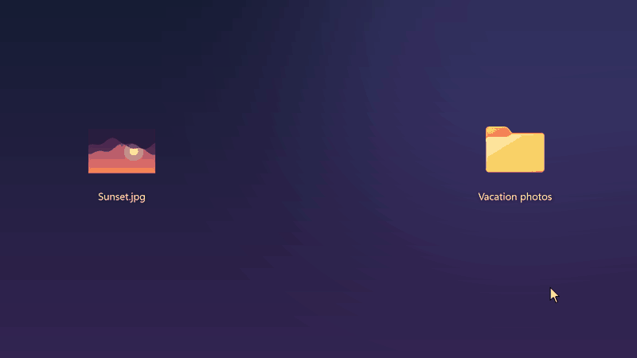
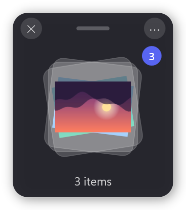
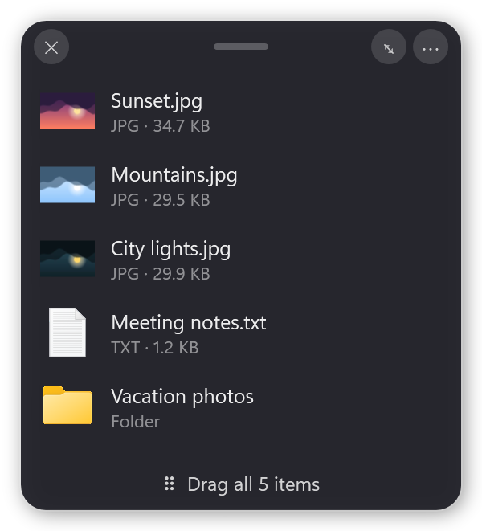
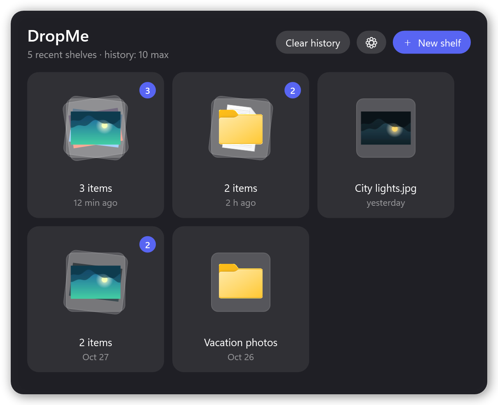

<div align="center">

# DropMe

**A drop zone that appears when you need it.**
Drag a file, give the mouse a quick shake, and a small shelf pops up to hold it
while you go find where it belongs.

[](https://github.com/JohanRouyer/DropMe/releases/latest)
[](LICENSE.md)


[**Download for Windows**](https://github.com/JohanRouyer/DropMe/releases/latest)



</div>

---

## Why DropMe?

Moving files on Windows often means juggling two Explorer windows, or dragging something halfway
across the screen only to realize the destination isn't open yet. DropMe gives you a place to put
things down for a moment:

1. **Start dragging** a file, a folder, an image from a web page, some text or a link.
2. **Shake the mouse** left and right. A shelf appears right next to the cursor.
3. **Drop it on the shelf**, then take your time: open the right folder, switch apps, collect more files.
4. **Drag the shelf** to where everything should go. Done.

No window to keep open, no hotkey to remember. It stays out of the way in the notification area
until you shake.

## What you get

- **Shelves that follow your workflow.** Collect files from several places onto one shelf, then
  move them all in a single drag, or click the stack to see each file and take them out one by one.
- **Works with more than files.** Images dragged from a browser are saved as real image files,
  not links. Text and URLs become `.txt` and `.url` files you can drop anywhere.
- **A short memory.** Closed shelves go into a history (3 to 50, your choice), so you can reopen
  the files you set aside earlier with one click from the tray icon.
- **Stays out of the way.** The shelf never steals focus from the app you're dragging from, and
  DropMe can start with Windows.
- **Updates itself.** New versions are announced once and install in one click, after checking the
  download against the checksum GitHub publishes.
- **Nothing is moved behind your back.** A shelf only holds references to your files; nothing is
  copied or deleted until you drag it somewhere yourself.

<p align="center">
  
  &nbsp;&nbsp;
  
  <br>
  <sub>A shelf collects your files; click it to see and drag each one.</sub>
</p>

<p align="center">
  
  <br>
  <sub>The DropMe window, from the tray icon: open and recent shelves, one click to bring them back.</sub>
</p>

## Get started

1. Download **`DropMe-Setup-<version>.exe`** from the [latest release](https://github.com/JohanRouyer/DropMe/releases/latest).
2. Run it. No admin rights and no .NET install needed (Windows 10/11, 64-bit).
3. Drag any file and shake the mouse.

The tray icon is where everything else lives: left-click it to see your open and recent shelves,
right-click it for settings.

## Good to know

- **Privacy.** DropMe works entirely on your PC. The only network requests are a daily, anonymous
  check of this repository's latest release (which you can turn off from the tray menu) and
  downloading images you drop from websites.
- **Where things are kept.** Images, text and links dropped from other apps are saved to
  `%TEMP%\DropMe`. History and settings live in `%APPDATA%\DropMe`. Uninstalling removes both.
- **Known limitation.** The shake is detected whenever the left mouse button is held, so it can
  occasionally trigger while selecting text or moving a window. Windows offers no reliable way to
  tell that a file drag is in progress. Closing the shelf is one click, and an empty shelf closes
  by itself when you let go.

## Building from source

Requires the .NET 8 SDK.

```
dotnet build -c Release
```

To build the installer you also need Inno Setup 6 (`winget install JRSoftware.InnoSetup`):

```
powershell -ExecutionPolicy Bypass -File installer\build-installer.ps1
```

This produces `dist\DropMe-Setup-<version>.exe`, with the version taken from `<Version>` in
`DropMe.csproj`. Releases are published as `v<version>` tags with that installer attached, which
is what the in-app updater looks for.

The images in `docs/` are rendered from DropMe's real windows with sample files, so they can be
regenerated after a UI change (the second step needs Python with Pillow):

```
dotnet run --project tools\screenshots -c Release -- docs %TEMP%\dropme-sprites
python tools\make_demo_gif.py %TEMP%\dropme-sprites docs\demo.gif
```

## License

DropMe is free for personal and other **noncommercial** use under the
[PolyForm Noncommercial License 1.0.0](LICENSE.md). You're welcome to use it, modify it and share
it, as long as you credit the author by keeping the license and this notice:

> Required Notice: Copyright (c) 2026 JohanRouyer (https://github.com/JohanRouyer/DropMe)

Commercial use isn't allowed. If you'd like to use DropMe commercially, open an issue to get in touch.
